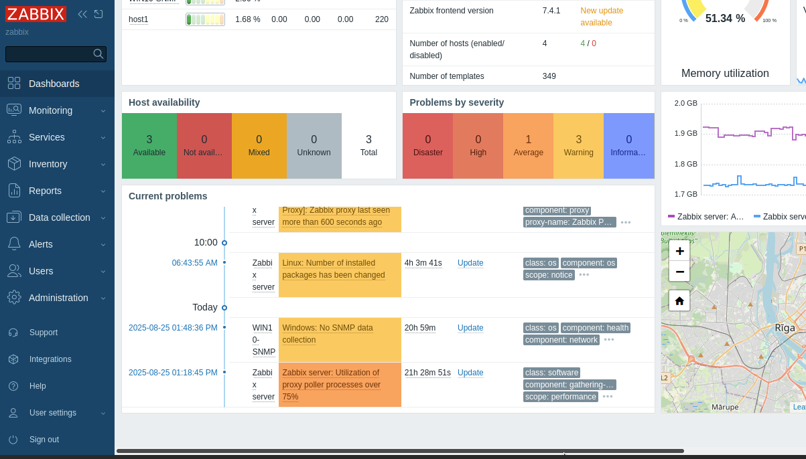
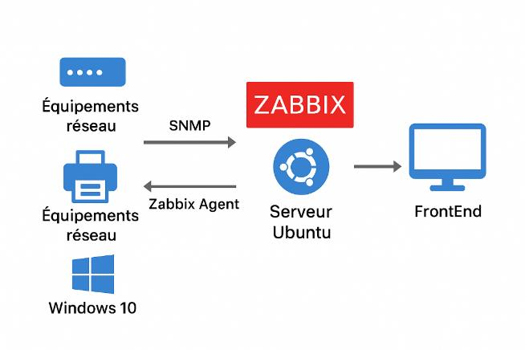
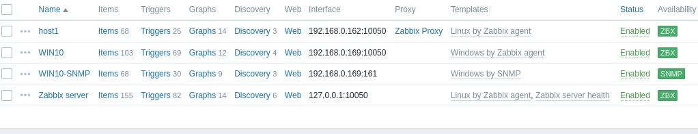
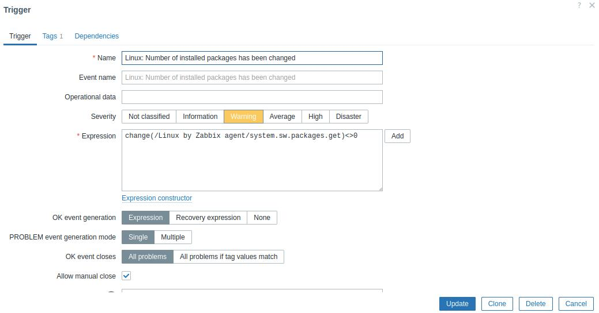

# Zabbix Infrastructure Monitoring — SNRT Internship

Implementation and testing of a **Zabbix 7.4** monitoring platform for the Radio Maintenance Service of **SNRT** (Moroccan national radio & television broadcaster), moving the team from reactive to **proactive maintenance**: continuous metric collection, threshold-based alerts and e-mail notifications.

> Internship project — SNRT, Rabat, August 2025 (test environment).

   

---

## The need

No continuous tracking of CPU, memory or disk usage meant problems were discovered only after they caused an outage. The service needed **multi-platform monitoring** (Windows, Linux, network equipment), **real-time e-mail alerts** and a **free, open-source** solution.

## Tool selection

| | Nagios | Prometheus | **Zabbix (selected)** |
|---|---|---|---|
| Data collection | External scripts | Pull of HTTP metrics | Native agents, **SNMP**, logs |
| Visualisation | Basic | External (Grafana) | **Built-in dashboards & graphs** |
| Alerting | Config files | External (Alertmanager) | **Integrated trigger engine** |
| Configuration | Manual | Several tools | **Reusable templates** |

Zabbix was chosen as an all-in-one platform that monitors heterogeneous environments (Windows, Linux, SNMP devices) with no licence cost.

## Architecture

| Component | Role |
|---|---|
| Zabbix server 7.4 | Collects data, evaluates triggers, raises alerts |
| MySQL | Configuration and history database |
| Apache2 + PHP 8.3 | Web frontend |
| Zabbix agents | Servers (Linux, Windows): CPU, memory, disk, services |
| SNMP | Agentless monitoring of network equipment and Windows hosts |
| **Zabbix proxy** | Collects locally for a group of hosts and forwards to the server — less load on the server, lower latency, simpler firewall rules |
| hMailServer | Internal SMTP server for e-mail notifications |

**Agent vs SNMP:** the native agent for servers (rich, secure, active mode through the proxy); SNMP for switches, routers and devices where no agent can be installed.

## Implementation

1. **Server installation** on an Ubuntu 24.04 VM: Apache2, PHP 8.3, MySQL; official Zabbix 7.4 repository; database creation and schema import; web setup wizard.
2. **Frontend issue fixed:** the setup failed PHP checks → tuned `php.ini` (`post_max_size`, `max_execution_time`, `max_input_time`).
3. **Agents** deployed on Linux and Windows hosts (`Hostname`, `Server`, `ServerActive` matched to the frontend configuration).
4. **SNMP** enabled on Windows with a read-only community; host first showed *Not available* because of a **community mismatch** → corrected on both sides, status back to *Enabled* (checked UDP 161/162, logs, `snmpwalk`).
5. **Zabbix proxy** installed (`zabbix-proxy-mysql`), linked to the server and registered in the frontend.
6. **Hosts, items, triggers, templates:** hosts grouped (Windows / Linux servers) and linked to templates such as *Windows by Zabbix agent*; custom items and triggers (low disk space, change in installed packages).
7. **Alerting:** SMTP media type pointing to hMailServer, actions linking triggers to user notifications.
8. **Stability fix:** dynamic IP addresses kept breaking agent ↔ server communication → static addressing for monitored hosts.

## Validation

| Test | Result |
|---|---|
| Artificial **disk saturation** on a monitored server | "Low disk space" problem raised immediately on the dashboard (Warning severity) |
| **SNMP on a Cisco switch** | Interface bandwidth, port status and CPU collected |
| **Custom dashboard** | Host availability, problems by severity, CPU and memory graphs at a glance |

## Next steps proposed

Extend monitoring to the whole SNRT IT estate, integrate with ticketing / messaging tools, and build custom templates for business applications.

## Skills demonstrated

Infrastructure monitoring · Zabbix server, agents & proxy · SNMP · Linux (Ubuntu) & Windows administration · LAMP stack · alerting & SMTP · troubleshooting · technical reporting

---

**Author:** Khaoula Belhaj — final-year engineering student, Communicating Systems & Computer Security, ENSA Fez · [LinkedIn](https://linkedin.com/in/khaoula-belhaj-1999163a6)
